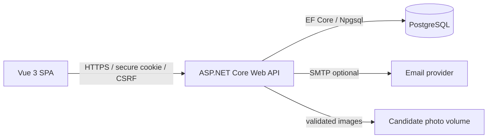

# IAUE SecureVote

**Design and Implementation of a Secure Electronic Voting System for Departmental Elections**  
Ignatius Ajuru University of Education, Port Harcourt, Rivers State, Nigeria  
Department of Computer Science - Final-Year Undergraduate Project

IAUE SecureVote is a configurable departmental electronic voting platform: a Vue 3 SPA, ASP.NET Core
Web API, PostgreSQL database, university-wide department configuration, scoped role-based
administration, privacy-conscious ballot submission, aggregate result approval/publication, Playwright
end-to-end tests and an optional Docker deployment. Computer Science is the discipline in which the project is
undertaken; it is not the only department the software serves.

> This is an academic project. It is not a certified election platform and must not be used for a real
> departmental election without institutional approval, physical/operational testing, an independent
> security review and a formal dispute procedure. The detector/modem, biometric identity and legal
> procedure are outside this application.

## Current status

| Item | Result |
|---|---|
| .NET 10 / ASP.NET Core API | Builds successfully |
| Vue 3 / TypeScript SPA | Typecheck and production build pass |
| Backend unit tests | **27 passed** |
| Backend integration tests (PostgreSQL) | **33 passed** |
| Frontend unit tests | **6 passed** |
| Playwright end-to-end tests | **3 passed** against the installed-PostgreSQL local stack |
| Total automated checks | **69 passed** |
| Installed PostgreSQL 18 | Local database/role and migrations verified |
| Docker Compose stack | Optional deployment; builds, starts and serves the SPA/API as non-root |
| Database backup/restore | Verified with `pg_dump`/`pg_restore` |
| Physical hardware / real election | **Not tested and not claimed** |

The canonical test evidence is in [docs/test-report.md](docs/test-report.md). The Phase 9 audit record,
including findings, remediation, load results and the readiness decision, is in
[docs/phase-9-audit-report.md](docs/phase-9-audit-report.md),
[docs/security-findings.md](docs/security-findings.md) and
[docs/phase-9-test-results.md](docs/phase-9-test-results.md). The university-wide department scope,
migration and final Phase 10 assessment are in
[docs/phase-10-scope-audit.md](docs/phase-10-scope-audit.md),
[docs/phase-10-implementation.md](docs/phase-10-implementation.md) and
[docs/phase-10-test-results.md](docs/phase-10-test-results.md).

## Highlights

- Responsive, accessible university-election interface for desktop, tablet and mobile.
- ASP.NET Core Identity authentication with secure cookies, CSRF protection and lockout.
- Data-driven departments with unique codes, optional faculty association, activation state and
  department-scoped election/student records.
- Server-side RBAC for Super Administrator, Electoral Officer, Student, Candidate and Observer, with
  explicit department assignments for officers and observers. Cross-department URL/ID tampering is
  rejected by the API.
- CSV voter-register import with one-time activation tokens (stored only as hashes), department
  name/code validation and row-level mismatch errors.
- Controlled election lifecycle:
  `Draft -> Scheduled -> Open -> Closed -> UnderReview -> Published`, with explicit
  Suspended/Cancelled states.
- Candidate nomination, approval/rejection, disqualification, manifesto and validated photo upload.
- Privacy-conscious ballot model:
  - identity and eligibility are separate from the anonymous ballot;
  - one-vote entitlement is consumed atomically;
  - ballots and selections have no student/user/receipt/IP/user-agent fields;
  - voter confirmation reference is non-revealing and stored only as a hash on the entitlement.
- Concurrent duplicate submissions are rejected; server-side validation rejects forged candidates,
  ineligible students and out-of-window submissions. Ballot rate limits are partitioned per
  authenticated voter, not globally.
- Aggregate results are calculated only from stored ballots. Observer verification and Super
  Administrator publication are required before students see results; snapshots carry a full-field
  integrity hash that is verified whenever they are read.
- Hash-chained audit trail with an API verification endpoint. The chain is tamper-evident, not
  tamper-proof against a privileged database administrator.
- CSV result export, print-friendly result pages and client-side PDF report generation.
- Installed-PostgreSQL local launcher and optional Docker Compose deployment.
- GitHub Actions CI workflow.

## Quick start with installed PostgreSQL (recommended)

Requirements: .NET SDK 10, Node.js 22+, and PostgreSQL 17 or newer installed and running on
`localhost:5432`. Docker is **not required**.

```powershell
# Run once. It uses POSTGRES_PASSWORD from .env as the postgres superuser password
# if present, or prompts for it. It creates securevote and securevote_test and
# writes ignored .env.local with the securevote_app connection strings.
.\database\setup-local.ps1

# Start the API and SPA with the installed PostgreSQL service.
.\run.cmd
```

Open <http://localhost:5173>. The API is at <http://localhost:5000>; migrations and the synthetic demo
seed run when the API starts. The application role is a non-superuser; the local demonstration password
is documented in `.env.example`. The setup script does not print credentials.

`run-local.ps1` loads `.env` and then `.env.local`; it does not require Docker. Direct backend startup is
also possible after setting `ConnectionStrings__Default` and `ASPNETCORE_ENVIRONMENT=Development`.

### Docker Compose (optional deployment)

Use this only when Docker is available. It is not the student/local default.

```powershell
Copy-Item .env.example .env
# Set strong local-only POSTGRES_PASSWORD and SEED_DEMO_PASSWORD values.
docker compose up -d --build
```

Open <http://localhost:8080>. Compose defaults to `ASPNETCORE_ENVIRONMENT=Production` and
`SEED_ENABLED=false`; `.env.example` deliberately opts into Development/demo seeding for a local
demonstration. **Do not use the demo configuration for a real election.** In production provide real
credentials through a secret store, terminate TLS at a trusted reverse proxy and follow
[docs/deployment.md](docs/deployment.md).

### Demonstration accounts

The demo seeder is enabled only when `Seed:Enabled` is true and a `Seed:DemoPassword` of at least 12
characters is supplied. Usernames are synthetic:

| Role | Username/email |
|---|---|
| Super Administrator | `superadmin@demo.iaue.edu.ng` |
| CS Electoral Officer | `officer@demo.iaue.edu.ng` |
| Mathematics Electoral Officer | `officer.math@demo.iaue.edu.ng` |
| Physics Electoral Officer | `officer.physics@demo.iaue.edu.ng` |
| CS Observer | `auditor@demo.iaue.edu.ng` |
| Mathematics Observer | `observer.math@demo.iaue.edu.ng` |
| Physics Observer | `observer.physics@demo.iaue.edu.ng` |
| CS student voter | `IAUE/CS/22/001` |
| Mathematics student voter | `IAUE/MTH/22/001` |
| Physics student voter | `IAUE/PHY/22/001` |
| Candidate accounts | CS `IAUE/CS/22/002` through `IAUE/CS/22/007`; additional synthetic candidates in Mathematics/Physics |

Use the `SEED_DEMO_PASSWORD` you set locally. No production password is committed. The seed contains
three clearly labelled synthetic departments (Computer Science, Mathematics and Physics), three
synthetic elections, scoped sample staff, students and candidates. Elections start as **Draft**; the
responsible officer must schedule and open an election before students can vote. See
[docs/phase-10-demo-scenario.md](docs/phase-10-demo-scenario.md).

## Local development

Requirements: .NET SDK 10.0.403+, Node 22+, and PostgreSQL 17+ installed. Docker is optional.

### 1. Database

Run the database setup once as described above. The setup creates `securevote` and `securevote_test`;
the latter is used by integration tests and must not be a production database.

### 2. Backend

```powershell
# run-local.ps1 loads these; this is the equivalent manual setup
$env:ASPNETCORE_ENVIRONMENT='Development'
$env:ASPNETCORE_URLS='http://localhost:5000'
$env:ConnectionStrings__Default='Host=localhost;Port=5432;Database=securevote;Username=securevote_app;Password=change-me-local'
$env:Seed__Enabled='true'
$env:Seed__DemoPassword='your-local-demo-password'
dotnet run --project backend/src/SecureVoting.Api/SecureVoting.Api.csproj --no-launch-profile
```

EF Core migrations run at startup. Startup also ensures roles, settings and optional demo data. Swagger
UI is not exposed; use `/openapi/v1.json` or an OpenAPI-compatible client.

### 3. Frontend

```powershell
cd frontend
npm ci
npm run dev
```

Open <http://localhost:5173>. Vite proxies `/api` to `http://localhost:5000`. The SPA uses secure
cookies, so do not replace the proxy with a cross-site API origin unless CORS/cookie configuration is
reviewed.

### 4. Test commands

```powershell
# Installed PostgreSQL: loads SECUREVOTING_TEST_CONNECTION from .env.local
.\test-local.ps1

# Or explicitly:
dotnet build backend/SecureVoting.slnx -c Release --no-restore
dotnet test backend/tests/SecureVoting.UnitTests/SecureVoting.UnitTests.csproj -c Release --no-build
dotnet test backend/tests/SecureVoting.IntegrationTests/SecureVoting.IntegrationTests.csproj -c Release --no-build

# Frontend
cd frontend
npm run typecheck
npm run test:unit
npm run build

# End-to-end against the local run.cmd stack
$env:SECUREVOTE_E2E_URL='http://localhost:5173'
npx playwright install chromium
npx playwright test --project=chromium
```

Integration tests use the installed `securevote_test` database when
`SECUREVOTING_TEST_CONNECTION` is set. Without that variable they retain the Docker/Testcontainers
fallback. They never use the development database; the fixture refuses any external database whose name
does not end in `_test`. Docker is therefore optional.

## Architecture



Layers:

- `SecureVoting.Domain` - entities, lifecycle, ballot/result rules.
- `SecureVoting.Application` - DTOs, validators, pure ballot/result/audit logic.
- `SecureVoting.Infrastructure` - EF Core/Identity, services, audit chain, imports, email, photos.
- `SecureVoting.Api` - controllers, authentication/authorization, antiforgery, rate limiting, security
  headers, OpenAPI, SPA hosting.
- `frontend` - Vue 3 SPA.
- `tests` - backend unit/integration and Playwright E2E.

Detailed diagrams, the threat model and database design are in
[docs/architecture.md](docs/architecture.md), [docs/database.md](docs/database.md) and
[docs/threat-model.md](docs/threat-model.md).

## Ballot privacy in one paragraph

Eligibility is identity-linked. A one-time `VoterEntitlement` row is unique per election/student and is
consumed with a conditional SQL update inside the ballot transaction. The anonymous ballot is inserted
with a random ID and no student/user/receipt/IP/user-agent field. Selections and abstentions reference
the ballot only. The voter's confirmation reference is random and only its SHA-256 hash is stored on
the entitlement. Ordinary APIs, dashboards, exports and audit events expose aggregates or
non-identifying events, never a voter-to-choice mapping. Residual timing and privileged database
correlation risks are documented.

## Security summary

- Cookie auth: HttpOnly, SameSite Strict, Secure outside Development.
- Antiforgery token on every unsafe API request.
- Server-side RBAC and fallback authenticated policy; frontend route hiding is not a security control.
- Rate limiting for login and ballot submission; Identity lockout.
- EF Core parameterization, strict input validation, JSON request limits and secure headers/CSP.
- Candidate photo magic-byte validation, size limit and generated storage name.
- Audit hash chain; no ballot choices in audit/logs.
- No real secrets, database passwords or SMTP credentials are committed.
- Published result versions are immutable through the application; corrections create a new version.

See [SECURITY.md](SECURITY.md) for assumptions and residual risks. Absolute anonymity, cryptographic
end-to-end verifiability and privileged-insider resistance are **not** claimed.

## Project documents

- [Requirements](docs/requirements.md)
- [Architecture and diagrams](docs/architecture.md)
- [Database/ERD](docs/database.md)
- [Threat model](docs/threat-model.md)
- [Use-case/activity/sequence diagrams](docs/diagrams.md)
- [Security](SECURITY.md)
- [Testing strategy](TESTING.md)
- [Actual test report](docs/test-report.md)
- [Deployment and backup/recovery](docs/deployment.md)
- [Student guide](docs/student-guide.md)
- [Electoral administrator guide](docs/administrator-guide.md)
- [Demo script](docs/demo-script.md)
- [Final-year report outline](docs/project-report-outline.md)
- [Defence presentation outline](docs/defence-outline.md)
- [Change log](CHANGELOG.md)

## Known limitations

- No physical electoral hardware, biometric identity provider or real university election procedure was
  tested. See [docs/test-report.md](docs/test-report.md).
- SMS/email OTP MFA is not implemented. Email is needed for password recovery; SMTP is optional.
- There is no application-level operator login/role beyond the provided roles; Windows/deployment access
  controls are still required.
- The database/journal/photo volume are not application-encrypted; protect them with host encryption,
  volume permissions and backups.
- No cryptographic end-to-end verifiable voting, homomorphic tally, mixnet or paper audit trail.
- Ranked-choice voting is not implemented.
- The audit chain is tamper-evident, not tamper-proof against a privileged database administrator who
  rewrites the whole chain and state. Department visibility metadata is not included in the hash chain;
  external checkpoints remain an advanced extension.
- Legacy elections/students retain their original department string columns and receive generated
  legacy department codes during migration. Institutions must review codes/assignments before real use.
- Faculty is an optional display string, not a separate organisational entity.
- The default demo seed is for local development/testing only; the application rejects enabled seeding
  in other environments.
- A synthetic 300-voter load is documented: clean at 12-way concurrency; 16-way final-image runs had
  intermittent activation transport failures; 32-way p95 exceeded 2 seconds. No higher-concurrency
  capacity is claimed. See [docs/performance-test-report.md](docs/performance-test-report.md).

## Licence and academic use

Academic project deliverable. No warranty is provided. Do not use it as a certified life-safety,
electoral or university record system without institutional approval.
