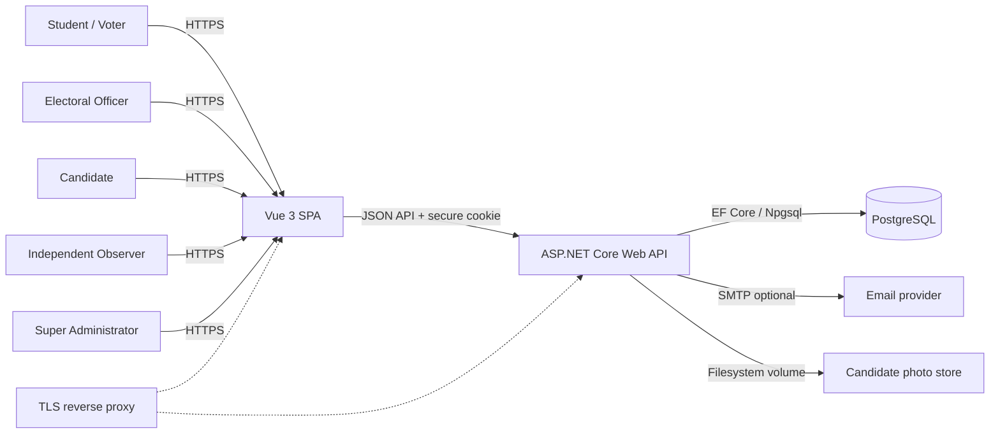
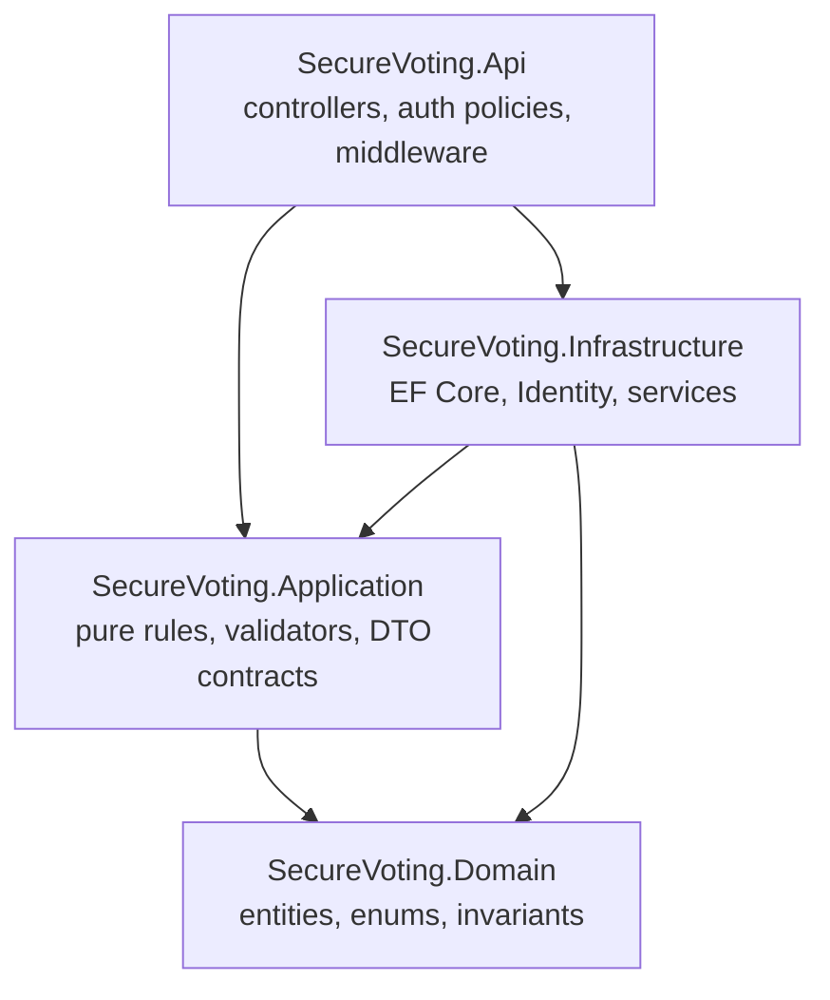
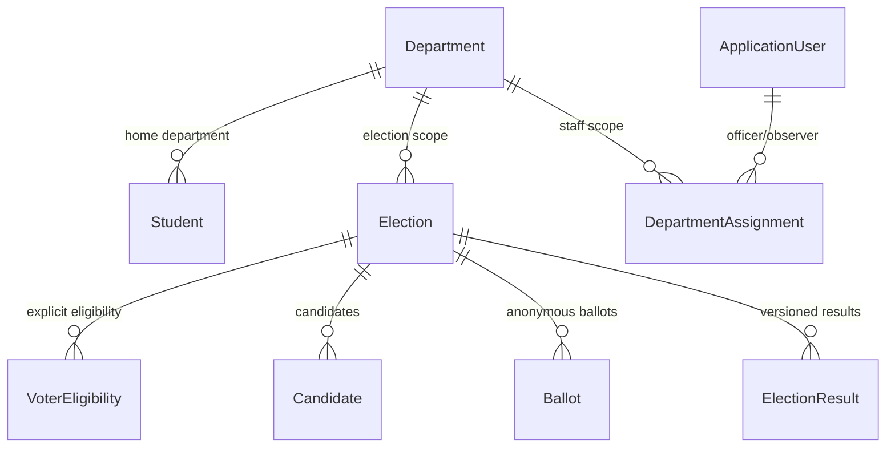
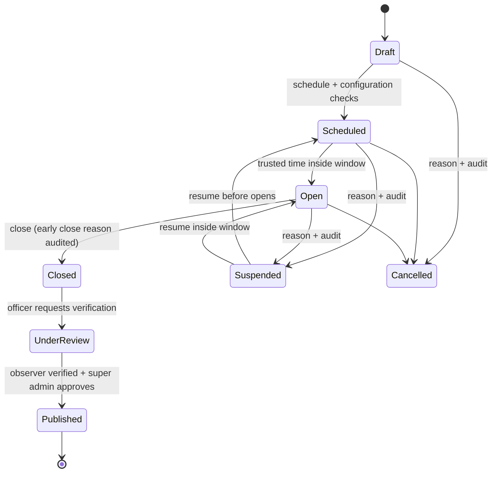

# System Architecture

## Context



## Layered backend



| Project | Responsibilities | Must not contain |
|---|---|---|
| `SecureVoting.Domain` | Entities, enums, state machine, ballot/result rules, domain exceptions | EF Core, ASP.NET Core, HTTP |
| `SecureVoting.Application` | Request/response DTOs, validators, pure election/ballot/result calculations, interfaces | DbContext, controllers |
| `SecureVoting.Infrastructure` | `AppDbContext`, Identity stores, migrations, audit chain, CSV, email, photo storage, transaction services | HTTP controllers, Vue |
| `SecureVoting.Api` | Controllers, authentication/authorization, antiforgery, rate limiting, exception mapping, OpenAPI, static SPA | Business rules duplicated in controllers |
| `SecureVoting.UnitTests` | Pure state, ballot, tally, audit hash and validation tests | Database/network dependency |
| `SecureVoting.IntegrationTests` | PostgreSQL + WebApplicationFactory API tests, concurrency/security tests | Production data |

## Authentication and session design

- ASP.NET Core Identity with cookie authentication.
- Cookies: `HttpOnly`, `SameSite=Strict`, `SecurePolicy=Always` outside Development, bounded lifetime.
- Antiforgery: cookie plus `X-CSRF-TOKEN` header; all unsafe API methods are validated automatically.
- The SPA bootstraps a request token from `GET /api/auth/csrf`; the cookie itself remains HttpOnly.
- Login uses `SignInManager` with lockout; Identity hashes passwords with its supported password hasher.
- Account active flag is checked before sign-in; suspension updates the security stamp.
- Authorization policies:
  - `ManageElections` - ElectoralOfficer
  - `ReviewResults` - ElectoralOfficer
  - `VerifyResults` - Observer
  - `PublishResults` - SuperAdministrator
  - `ManageUsers` / `ManageSettings` - SuperAdministrator
  - `ViewAudit` - SuperAdministrator or Observer
  - `CandidatePortal` - Candidate
  - `StudentPortal` - Student
- Fallback policy requires an authenticated user. Anonymous endpoints are explicit and minimal.

## Department and staff scope

`Department` is the organisational record for a departmental election. `Student` and `Election` carry a
required `DepartmentId`; voter eligibility remains an explicit per-election row.

`DepartmentAssignment` links an existing `ElectoralOfficer` or `Observer` user to a department and a
scope. A user may be assigned to multiple departments. `SuperAdministrator` retains documented
university-wide oversight; no new role was introduced. `DepartmentAccessService` enforces scope in the
server-side controllers and services for election management, voter import, candidate decisions,
result review/verification, published results, photos, announcements, audit list and dashboard views.



Frontend filtering is not an authorization boundary. Requests for a department/election outside the
current user's assignment are rejected by the API even if the identifier is changed in a URL or body.
## Ballot submission sequence

```mermaid
sequenceDiagram
    participant V as Student browser
    participant A as API
    participant DB as PostgreSQL
    V->>A: POST /api/elections/{id}/ballots + selections + CSRF
    A->>A: Authenticate, authorize Student, validate DTO
    A->>DB: BEGIN
    A->>DB: Lock election row FOR UPDATE
    A->>DB: Capture trusted time after lock; verify Open/window
    A->>DB: Verify eligibility and entitlement exists
    A->>DB: Validate positions/candidates are approved and belong to election
    A->>DB: UPDATE entitlement SET ConsumedAt WHERE ConsumedAt IS NULL
    alt zero rows updated
        DB-->>A: no entitlement available
        A-->>V: 409 already voted / concurrent submission
        A->>DB: ROLLBACK
    else one row updated
        A->>DB: INSERT ballot (random id) + selections + internal receipt
        A->>DB: Append hash-chained audit event (no choices)
        A->>DB: COMMIT
        A-->>V: 201 confirmation reference only
    end
```

Key properties:

- The identity-linked entitlement and anonymous ballot are committed in the same transaction.
- The ballot has no student/user key.
- The confirmation code is random and stored only as a hash on the entitlement.
- No API returns an individual ballot or identity-to-choice mapping.
- The database row lock/conditional update serializes concurrent submissions for one entitlement.

## Result publication sequence



- Ballot acceptance checks the election status and server time independently of UI.
- A background lifecycle worker closes expired Open elections; it does not fabricate results.
- Results are calculated from `Ballots`, `BallotSelections` and `BallotAbstentions`.
- A provisional result snapshot is persisted, observer verification is recorded, and only a
  Super Administrator can publish it.
- Each result snapshot carries a canonical full-field SHA-256 integrity hash. Snapshot mapping verifies
  the hash and returns 409 if the stored evidence was altered.
- Published snapshots and lines are immutable through the application. Corrections/recounts create a
  new version with a reason and prior-result reference.

## Privacy boundaries

| Concern | Treatment |
|---|---|
| Voter identity | `Students`, Identity users, `VoterEligibility` |
| One-vote entitlement | `VoterEntitlements` - unique election/student, consumed once |
| Ballot | `Ballots` - random ID, election/time only; no voter/user/IP/agent |
| Choices | `BallotSelections` and `BallotAbstentions` linked only to ballot |
| Receipt | Internal `BallotReceipts` linked only to ballot; voter confirmation hash on entitlement |
| Results | Aggregate snapshots/lines; no ballot or voter identifiers exposed |
| Audit | Actor/correlation/event/outcome; no choices and no ballot-to-identity relation |

Residual risks: timing correlation, database administrator access, application administrator access,
backup access, compromised API process and infrastructure logs. Complete anonymity is not claimed;
the design minimizes direct links and documents the remaining trust boundary.

## Frontend architecture

```text
src/
  api/            typed fetch client, CSRF bootstrap, error handling
  components/     shell, cards, badges, dialogs, tables, states, charts
  features/       auth, student, candidate, administration, auditor, results
  router/         route guards and role-aware navigation
  stores/         session/auth/toasts
  types/          API contracts
  views/          route-level pages
```

- Vue 3 `<script setup>`, strict TypeScript.
- Pinia for session/toast state; no sensitive ballot state persisted.
- VeeValidate + Zod for forms.
- Chart.js for aggregate analytics only.
- jsPDF from aggregate result data for PDF export.
- Tailwind CSS responsive theme with university green/gold palette.
- Auth and CSRF data loaded before protected routes; 401/403 handled centrally.
- Ballot selections exist only in memory until submission; explicit review/confirmation.
- No placeholder controls; unavailable operations are not rendered or are disabled with an explanation.

## Runtime and deployment

- Development (default): installed PostgreSQL service plus .NET API and Vite dev server; Vite proxies `/api`.
- Optional Docker: Compose stack with PostgreSQL + API; secrets supplied through environment variables.
- Production image: multi-stage Node build -> .NET publish -> static SPA served from API `wwwroot`.
- TLS is terminated by a reverse proxy/load balancer in deployed environments; HTTP is local-only.
- Data Protection keys, candidate photos and PostgreSQL data use persistent volumes.
- Health endpoint verifies API and database readiness.
- OpenAPI document at `/openapi/v1.json`; Swagger UI is not exposed by default.
- CI builds/tests backend and frontend and runs Playwright where browser installation is available.

## Logging and observability

- ASP.NET Core structured logging; JSON console outside Development.
- Request correlation ID propagated in response and audit where available.
- Exception handler maps domain conflicts/validation/authorization to ProblemDetails.
- No request body logging; no ballot choices, passwords, reset tokens or activation tokens in logs.
- Audit chain is stored in PostgreSQL and can be verified by an authorized auditor/super administrator.
- Database health check is exposed through `/health`.

## Key decisions and trade-offs

1. Cookie auth + CSRF instead of bearer tokens in browser storage, reducing token theft by XSS.
2. A relational entitlement row consumed in the same transaction as the anonymous ballot, providing
   database-enforced one-vote behavior without a voter key on the ballot.
3. PostgreSQL rather than SQLite for row-level concurrency and production deployment.
4. Application-level hash chain rather than inventing cryptographic E2E verifiability.
5. SMTP optional; in-app notification records remain the reliable local notification history.
6. No destructive deletes for election evidence; retention/deletion is restricted and documented.
