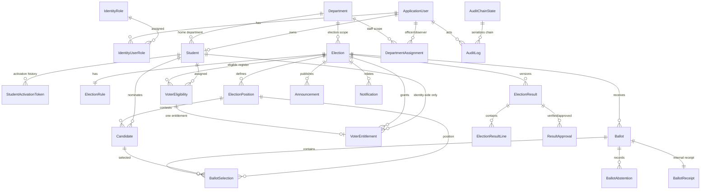

# Database Design

## Technology and conventions

- PostgreSQL 17 (Docker image `postgres:17-alpine` planned).
- EF Core 10 + Npgsql provider; migrations are the only supported schema creation path.
- Primary keys: `uuid` for application entities and Identity users/roles.
- Timestamps: `timestamptz`; all application writes use UTC via injected `TimeProvider`.
- Enum values stored as strings for readability/filtered indexes unless noted.
- Optimistic concurrency uses PostgreSQL `xmin` on mutable election configuration rows.
- Foreign keys use restrictive deletes for election evidence. Candidate withdraw/disqualify is a status
  change, not a physical delete.
- Unique indexes and check constraints enforce integrity in addition to application validation.

## Entity-relationship overview

### Critical privacy boundary

There is **no foreign key or application relation from `Ballots` or `BallotSelections` to
`Students`, `VoterEligibility` or `VoterEntitlements`**.

One-vote enforcement:

1. `VoterEntitlements(ElectionId, StudentId)` is unique.
2. It is seeded for each eligible voter.
3. Submission performs a conditional update:
   `UPDATE "VoterEntitlements" SET "ConsumedAtUtc" = now WHERE "Id" = @id AND "ConsumedAtUtc" IS NULL`.
4. Zero affected rows -> reject (`AlreadyVoted`/conflict).
5. One affected row -> insert anonymous ballot and selections in the same transaction.
6. Commit. A rollback restores the unconsumed entitlement and removes the ballot.

The confirmation code is returned to the voter, but only its SHA-256 hash is stored on the
entitlement. The anonymous ballot has no confirmation code. The internal ballot receipt lets
aggregate/reconciliation checks be performed without revealing the voter.

## Tables

### Identity

- `AspNetUsers`: Identity users. `MatricNumber` is the username for student accounts; email is unique.
  Custom fields: `DisplayName`, `IsActive`, `CreatedAtUtc`.
- `AspNetRoles`: `SuperAdministrator`, `ElectoralOfficer`, `Student`, `Candidate`, `Observer`.
- `AspNetUserRoles`, `AspNetUserClaims`, `AspNetRoleClaims`, `AspNetUserLogins`, `AspNetUserTokens`:
  Identity-managed.
- Suspension sets `IsActive = false` and rotates the security stamp.

### Departments and staff scope

`Departments`: `Id uuid PK`, `Name varchar(160)`, `Code varchar(20)`, `CodeNormalized varchar(20) unique`,
`Faculty varchar(160) nullable`, `IsActive boolean`, `CreatedAtUtc`, `UpdatedAtUtc`. Codes are
case-insensitively unique. Departments are deactivated, not deleted.

`DepartmentAssignments`: `Id uuid PK`, `UserId FK AspNetUsers`, `DepartmentId FK Departments`,
`Scope` (`ElectoralOfficer|Observer`), `CreatedByUserId`, `CreatedAtUtc`. Unique
`(UserId, DepartmentId, Scope)`. Existing roles remain global; assignments narrow the officer/observer
scope. Super Administrators retain global oversight.

### Students

`Id uuid PK`, `MatricNumber varchar(40) unique`, `FullName`, `Email unique`, `DepartmentId FK
Departments`, legacy `Department varchar(120)` display/migration snapshot, `Level`, `IsActive`,
`UserId uuid nullable unique FK AspNetUsers`, `CreatedAtUtc`, `UpdatedAtUtc`.

`StudentActivationTokens`: `Id`, `StudentId FK`, `TokenHash char(64) unique`, `ExpiresAtUtc`,
`UsedAtUtc`, `CreatedByUserId`, `CreatedAtUtc`. Only a hash is stored. Plaintext is returned once to
the controlling officer and is never logged.

### Elections

`Elections`: `Id`, `Title`, `Description`, `AcademicSession`, `DepartmentId FK Departments`, legacy
`Department varchar(120) display/migration snapshot`, `Status`,
`NominationOpensAtUtc`, `NominationClosesAtUtc`, `OpensAtUtc`, `ClosesAtUtc`,
`SuspendedFromStatus` nullable, `SuspensionReason`, `ClosureReason`, `CancellationReason`,
`ResultsRequestedAtUtc`, `PublishedAtUtc`, `CreatedByUserId`, `CreatedAtUtc`, `UpdatedAtUtc`,
`Version xmin`.

Checks: `ClosesAtUtc > OpensAtUtc`; `NominationClosesAtUtc <= OpensAtUtc`; reasons required for
suspended/cancelled states (application + DB check where practical).

`ElectionRules`: 1:1 `ElectionId`, `TieHandling` (`RunoffRequired|SharedOffice|ManualResolution`),
`AllowAbstention`, `RequireFullSlate`, `NominationRequiresApproval`, created/updated.

`ElectionPositions`: `Id`, `ElectionId`, `Title`, `Description`, `DisplayOrder`, `SeatCount`,
`MaxSelections`, `IsActive`, timestamps. Unique `(ElectionId, Title)`; checks
`1 <= MaxSelections <= SeatCount`.

`VoterEligibility`: `Id`, `ElectionId`, `StudentId`, `IsEligible`, `ImportedAtUtc`, `Source`.
Unique `(ElectionId, StudentId)`. This is the officer-controlled register.

### Candidates

`Candidates`: `Id`, `ElectionId`, `PositionId`, `StudentId`, `DisplayName`, `Manifesto`,
`PhotoFileName`, `Status`, `RejectionReason`, `WithdrawalReason`, `SubmittedAtUtc`,
`ReviewedAtUtc`, `ReviewedByUserId`, timestamps. Unique `(ElectionId, StudentId)`;
index `(ElectionId, PositionId, Status)`.

Rules:
- Candidate position must belong to the same election.
- Candidate student must be in the election eligibility register.
- Approved candidate details are frozen once the election opens.
- Nomination is unavailable after the nomination deadline or after Open.

### Entitlements and ballot

`VoterEntitlements`: `Id`, `ElectionId`, `StudentId`, `VoterEligibilityId`, `CreatedAtUtc`,
`ConsumedAtUtc`, `ConfirmationCodeHash char(64)`. Unique `(ElectionId, StudentId)` and unique
`VoterEligibilityId`. **No BallotId.** Row is updated conditionally during submission.

`Ballots`: `Id uuid random`, `ElectionId`, `SubmittedAtUtc`, `ContentHash char(64)`. No identity,
IP, user agent, receipt token or confirmation code. `ContentHash` covers sorted canonical selections
for integrity/reconciliation. It is not a voter identifier.

`BallotSelections`: `Id`, `BallotId`, `ElectionPositionId`, `CandidateId`, `CreatedAtUtc`.
Unique `(BallotId, ElectionPositionId, CandidateId)` and index `(ElectionId via ballot, position,
candidate)` is achieved through joins; a redundant `ElectionId` is intentionally not stored to keep
the ballot boundary minimal.

`BallotAbstentions`: `Id`, `BallotId`, `ElectionPositionId`, `CreatedAtUtc`. Unique
`(BallotId, ElectionPositionId)`. A position has either selections or an abstention, not both.

`BallotReceipts`: `Id`, `BallotId unique`, `ReceiptHash char(64) unique`, `CreatedAtUtc`.
Internal integrity/reconciliation only; no voter key and no public lookup endpoint.

### Results

`ElectionResults`: `Id`, `ElectionId`, `Version int`, `Status`
(`Provisional|Verified|Published|Superseded`), `TotalEligible`, `TotalBallots`, `TurnoutPercentage`,
`GeneratedAtUtc`, `GeneratedByUserId`, `VerifiedAtUtc`, `PublishedAtUtc`, `PublishedByUserId`,
`PreviousResultId`, `ChangeReason`, `IntegrityHash`. Unique `(ElectionId, Version)`;
published rows are immutable in application code and protected by a filtered unique index.
`IntegrityHash` is a canonical SHA-256 over the aggregate totals and every result-line field
(seats, abstentions, percentage, rank, winner, tie, turnout). Readers verify it and return 409 on a
mismatch. It is integrity evidence, not a signature. Snapshots created before Phase 9 use an older hash
format and require a migration or fresh result history.

`ElectionResultLines`: `Id`, `ElectionResultId`, `PositionId`, `CandidateId`, `VoteCount`,
`PositionSeatCount`, `PositionAbstentions`, `Percentage`, `Rank`, `IsWinner`, `IsTie`. Unique `(ResultId, PositionId, CandidateId)`.

`ResultApprovals`: `Id`, `ElectionResultId`, `UserId`, `Role`, `ApprovalType`, `Decision`,
`Notes`, `CreatedAtUtc`. Unique `(ElectionResultId, UserId, ApprovalType)`.

### Announcements, notifications, settings

`Announcements`: `Id`, `ElectionId nullable`, `Title`, `Body`, `Audience`, `PublishedAtUtc`,
`CreatedByUserId`, timestamps.

`Notifications`: `Id`, `UserId nullable`, `StudentId nullable`, `ElectionId nullable`, `Type`,
`Subject`, `Body`, `Channel` (`InApp|Email`), `Status` (`Pending|Sent|Failed|Skipped`),
`CreatedAtUtc`, `SentAtUtc`, `ErrorSummary`. No ballot content.

`SystemSettings`: `Id`, `Key unique`, `Value`, `UpdatedAtUtc`. Non-secret settings only; secrets come
from environment/secret store.

### Audit

`AuditLogs`: `Id`, `Sequence bigint unique`, `EventId uuid unique`, `OccurredAtUtc`, `ActorUserId`
nullable, `ActorDisplay`, `EventType`, `EntityType`, `EntityId`, `Outcome`, `CorrelationId`,
`DepartmentId nullable FK Departments` (visibility metadata, not part of the hash), `DetailsJson jsonb`,
`PreviousHash char(64)`, `Hash char(64)`, `CreatedAtUtc`.

`AuditChainState`: singleton `Id=1`, `LastSequence`, `LastHash`, `UpdatedAtUtc`. Appends lock this row
with `FOR UPDATE` inside the same transaction as the audited action. This serializes the chain.
Verification recomputes from sequence 1.

Limitations: hash chaining detects alteration/removal by someone who cannot recompute the whole chain;
a database administrator can rewrite the chain. Department scope metadata controls observer list
visibility but is not included in the existing hash, so a privileged administrator can alter visibility
metadata without invalidating an old hash. External checkpoints and restricted DB roles are required for
a production trust boundary.

## Migration and compatibility

`20261029120236_AddDepartmentsAndScopedAccess` adds `Departments`, `DepartmentAssignments`, required
`DepartmentId` columns and nullable audit scope metadata. It creates departments from distinct legacy
`Department` strings, assigns generated `LEGACY-<hash>` codes, backfills foreign keys and preserves
legacy string columns. A disposable PostgreSQL drill verified that synthetic legacy elections/students
retain their records and resolve to the new department. Legacy codes must be reviewed by the
institution; the demo seeder can normalize matching known sample names.

## Indexes and constraints summary

- Unique: student matric/email, election position title, candidate election/student,
  voter eligibility election/student, entitlement election/student, ballot selection triple,
  abstention ballot/position, receipt hashes, result version, approval triple, audit sequence/event.
- Filtered unique: one published result per election; one active/open? not needed because state machine.
- Foreign keys: all evidence-related deletes restrict; status changes replace deletes.
- Indexes: election status/opening, voter eligibility, candidate status, ballot position/candidate,
  audit occurred/event/actor, notifications user/created.

## Deletion and retention

- No physical deletion endpoint for elections, ballots, candidates or audit records.
- Eligibility removal is a register correction before voting opens, audited; never after ballots exist.
- Candidate withdrawal/rejection is status-based and preserves the row.
- Results are versioned, never updated after publication.
- Audit logs retained for the life of the election record; archival is an administrative database
  procedure, not an application feature.
- Backups are encrypted/protected by infrastructure policy; documented in deployment guide.

## Transaction boundaries

1. **Ballot submission:** entitlement consume + ballot + selections/abstentions + receipt + audit.
2. **Election lifecycle:** state update + audit in one transaction with optimistic concurrency.
3. **Result generation/publication:** snapshot + lines + approval + audit; published snapshot immutable.
4. **Import:** validated register rows + entitlement rows + activation records + audit.
5. **Role change:** Identity role change + security stamp + audit using the same transaction where
   supported by Identity stores.

## Migration policy

- Migrations generated from the EF model and committed.
- `Database.Migrate()` is run only by startup/operations; no `EnsureCreated()` in production.
- Migrations are tested against a clean PostgreSQL container.
- No destructive migration is applied without explicit review and backup.
