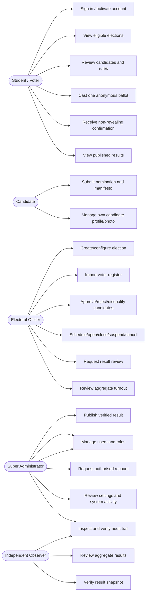
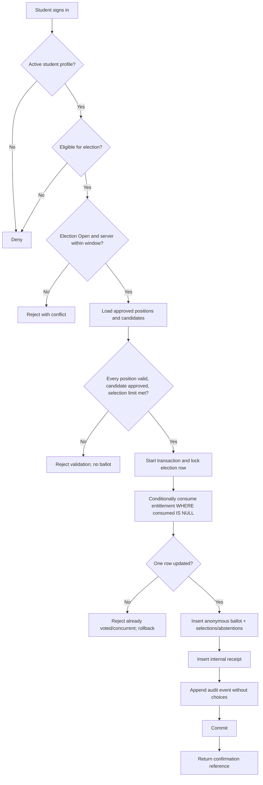
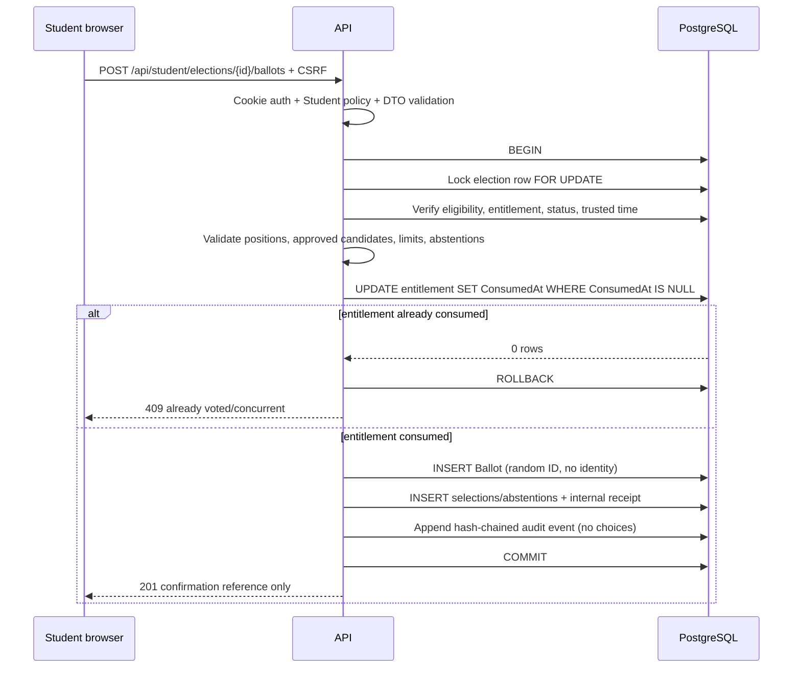
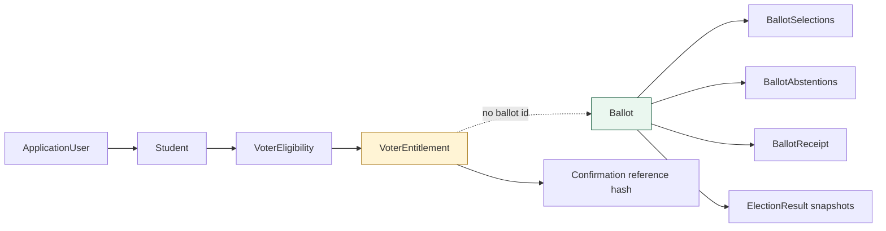

# Use-Case, Activity and Sequence Diagrams

## Use-case diagram



## Ballot-submission activity diagram



## Ballot submission sequence



## Result publication sequence

```mermaid
sequenceDiagram
    participant O as Electoral Officer
    participant A as API
    participant DB as PostgreSQL
    participant R as Observer
    participant S as Super Administrator
    O->>A: POST results/review
    A->>DB: Lock election, verify Closed
    A->>DB: Compute aggregate snapshot from accepted ballots
    A->>DB: Set UnderReview + audit
    A-->>O: provisional result
    R->>A: POST results/{resultId}/verify + notes
    A->>DB: Verify latest snapshot + record observer approval
    A-->>R: Verified snapshot
    S->>A: POST results/{resultId}/publish + notes
    A->>DB: Verify observer approval + latest version
    A->>DB: Mark earlier published version Superseded
    A->>DB: Mark result Published; set election Published; audit
    A-->>S: Published result
```

## Privacy boundary diagram



The dotted relationship is deliberately **not** a database relation: the entitlement and anonymous
ballot are only joined by the submission transaction, not by a stored voter key.
