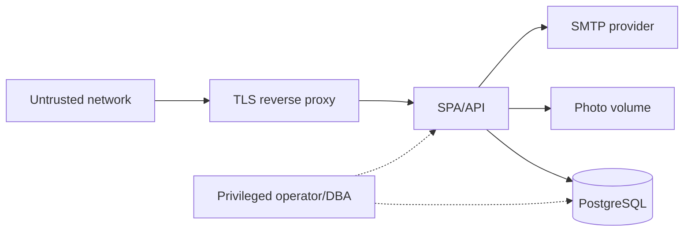

# Threat Model

## Assets

- Ballot selections and their confidentiality.
- The one-vote entitlement per eligible student.
- Integrity of accepted ballots, counts, result snapshots and published results.
- Student identity/contact data and eligibility registers.
- Administrator, officer and observer credentials and sessions.
- Audit evidence and its chain.
- Candidate photos/manifestos and election configuration.
- Database backups and Data Protection keys.

## Trust boundaries and actors

Actors considered: anonymous internet attacker, credential-stuffing attacker, malicious/compromised
student account, candidate account, electoral officer, super administrator, observer, database
administrator, application/server administrator, backup holder and a compromised dependency.

## Threats and controls

| ID | Threat | Impact | Controls | Residual |
|---|---|---|---|---|
| T01 | Broken object/function authorization | Escalation, cross-department access | Server-side role policies plus department-scoped `DepartmentAccessService`; DTO-scoped queries; deny-by-default; negative cross-department integration tests | Misconfigured/new endpoint; assignment error |
| T02 | SQL injection | Data/system compromise | EF Core parameterization; no user-controlled raw SQL; validated queries | Provider vulnerability |
| T03 | XSS / session theft | Account takeover | Vue escaping, no `v-html` of untrusted data, CSP, HttpOnly cookies, no token in localStorage | Browser/third-party compromise |
| T04 | CSRF | State change as victim | Strict SameSite cookies, antiforgery cookie + header on unsafe methods, origin/CORS restrictions | Misconfigured proxy |
| T05 | Credential stuffing | Account takeover | Identity lockout, rate limiting, strong password policy, no account enumeration, secure reset | Distributed slow attacks |
| T06 | Session fixation/hijacking | Impersonation | ASP.NET Core cookie regeneration, security stamp, HttpOnly/secure cookies, idle expiry, HTTPS | Stolen device |
| T07 | Duplicate ballot | Multiple votes | Unique entitlement, conditional atomic update, one transaction, 409 on retry | None known for same entitlement |
| T08 | Race condition | Over-count/tampered state | PostgreSQL transaction, conditional update, row version, unique constraints, concurrency tests | PostgreSQL failure |
| T09 | Ballot forgery/forged candidate | Invalid choices counted | Server validates authentication, eligibility, election window, approved candidate, position mapping, selection count; no frontend totals | Malicious DB administrator |
| T10 | Unauthorized result modification | False winner | Results computed server-side from ballots; full-field snapshot integrity hash verified on read; published snapshots immutable; role-separated verification/publication; audit | SuperAdmin + DBA collusion; external checkpoints absent; legacy pre-Phase-9 hashes are incompatible |
| T11 | Ballot secrecy violation | Coercion/trust loss | No identity on ballot; entitlement separate; no receipt-to-ballot lookup; aggregate-only endpoints; no choices in logs/audit | Timing correlation and privileged DB access |
| T12 | Sensitive data leakage | Privacy breach | Masks in logs, no request bodies, ProblemDetails without secrets, photo type/size checks, access-controlled exports | Operator exports/PII handling |
| T13 | Malicious file upload | Code execution/XSS | Allow JPEG/PNG/WebP, magic-byte sniff, 2 MB limit, generated filename, stored outside static web root, authenticated retrieval | Image parser/library not used; residual malformed-image risk |
| T14 | Dependency vulnerability | Compromise/DoS | Supported stable packages, lockfiles, CI build, vulnerability scan step documented | Zero-day |
| T15 | Denial of service | Unavailability | Rate limits partitioned per authenticated voter for ballots, login limits by IP, bounded payloads, DB indexes, reverse proxy limits, health checks; 300-voter test at 12-way concurrency | 16-way final-image activation transport failures; 32-way p95 exceeded 2 s; no HA |
| T16 | Backup exposure | Vote/identity disclosure | Backups contain sensitive data; documented encryption/ACL/offline retention; no backup download endpoint | Infrastructure admin access |
| T17 | Privileged insider | Tampering | Least privilege, audit chain, full-field result integrity hash, separation of duties, immutable snapshots, DB audit/checkpoints recommended | DBA can rewrite data, hash and chain; no HSM/external anchor |
| T18 | Identity verification failure | Someone votes using another matric | Controlled register import, one-time activation token, lockout, account suspension, officer oversight | No biometric/institutional IdP proof |
| T19 | Voter coercion | Vote buying/coercion | Private ballot areas, receipt contains no choices, no remote verification of choice | Client device compromise/coercion |
| T20 | Audit evidence deletion | Loss of accountability | Append-only application logic, hash chain, no delete endpoint, DB backup | Privileged DB deletion/whole-chain rewrite |
| T21 | Log injection / secrets | Investigation leakage | Structured logging, no body logging, sanitized DTO fields, no tokens/passwords logged | Exception messages from dependencies |
| T22 | Email abuse | Spam/credential leak | SMTP optional, notification templates exclude choices, no passwords/tokens in email except approved reset link | SMTP provider compromise |
| T23 | Direct database manipulation | Ballot stuffing | DB permissions restricted, audit, reconciliation, integrity hashes; not fully prevented by app | DBA access |
| T24 | Downtime during voting | Disenfranchisement | Health checks, backup/restore runbook, reverse proxy, monitored host; no HA claimed | Single-instance baseline |
| T25 | Cross-department election ID tampering | Disclosure or unauthorised management | Server-side election department lookup, officer/observer assignment checks on every scoped endpoint; list filtering; response 403; negative tests | A new endpoint that forgets the scope check |
| T26 | Incorrect staff assignment | Officer/observer sees or changes wrong department | SuperAdministrator-only assignment endpoint, role-required scopes, audited assignment changes, security-stamp update, department lists | Human/data-entry error; no HR integration |
| T27 | Legacy department ambiguity | Wrong historical record grouping | Migration preserves legacy strings, creates explicit departments and backfills foreign keys; migration drill; review of generated LEGACY codes required | Institutional review not yet performed |
| T28 | Audit scope metadata alteration | Observer visibility changed without hash failure | Department visibility metadata separated from hashed event content; privileged DB controls/checkpoints still required | DBA can alter visibility metadata; hash chain does not cover it |

## Abuse cases explicitly blocked

- Unauthenticated submission.
- Student submitting for another student.
- Ineligible student submitting.
- Candidate or observer calling administrative endpoints.
- Student accessing another student's profile or eligibility record.
- Invalid/foreign candidate ID or position ID.
- Selecting more candidates than allowed, duplicate candidates, or missing required positions.
- Second submission for the same election.
- Submission after close/outside the trusted window.
- Frontend-supplied totals being accepted as authoritative.
- Published result mutation without a new version.
- Ballot choices in audit logs, result exports or notifications.

## Cryptographic choices

- Passwords: ASP.NET Core Identity's supported password hasher; no custom scheme.
- Activation/reset/confirmation tokens: cryptographically random 256-bit values; only hashes stored for
  activation and confirmation. Identity tokens are used for password reset with data protection.
- Audit chain: SHA-256 over canonical event fields plus previous hash. This is integrity evidence, not
  a digital signature.
- TLS: required at the reverse proxy for deployed environments. Local HTTP is development-only.
- No custom encryption algorithm and no claim of end-to-end verifiable voting.

## Assumptions

- The server clock is trusted and synchronised (NTP or equivalent); ballot time is read after the
  election row lock.
- TLS terminates at an institution-controlled proxy; secure-cookie policy is enabled outside dev.
- If forwarded headers are enabled, the API is reachable only through a proxy that strips
  client-supplied `Forwarded`/`X-Forwarded-*` values. The application does not trust them by default.
- The reverse proxy, operating system, PostgreSQL and Data Protection keys are institutionally
  protected. The container runtime is non-root, but host/volume access remains privileged.
- Only authorised officers can distribute activation tokens.
- Super Administrators create departments and assign officers/observers; assignments are reviewed by the
  institution before a real election.
- SMTP is optional; absence of email does not break voting.
- Election legal procedures, candidate eligibility rules and dispute resolution are manual processes
  outside this software.

## Security acceptance gates

- Integration tests prove 401/403, duplicate rejection, forged candidate rejection, closure window,
  concurrent one-vote behavior, activation-token reuse/expiry, audit deletion/tamper and result-hash
  tamper detection.
- Logs/audit never contain ballot choices or plaintext credentials/tokens.
- Published result mutation is impossible through API; a new version and integrity hash are required.
- CSRF token is required on all unsafe methods; ballot limits are per authenticated voter.
- Clean database migration/seed and restore procedure are verified on synthetic data.
- Demo seeding is rejected outside Development/Testing.
- The 12-way 300-voter demonstration is clean under the Phase 9 schema; Phase 10 schema performance is
  not claimed.
- Cross-department election, eligibility, import, result and audit isolation tests pass.
- An independent review and penetration test are still required before a real election.
